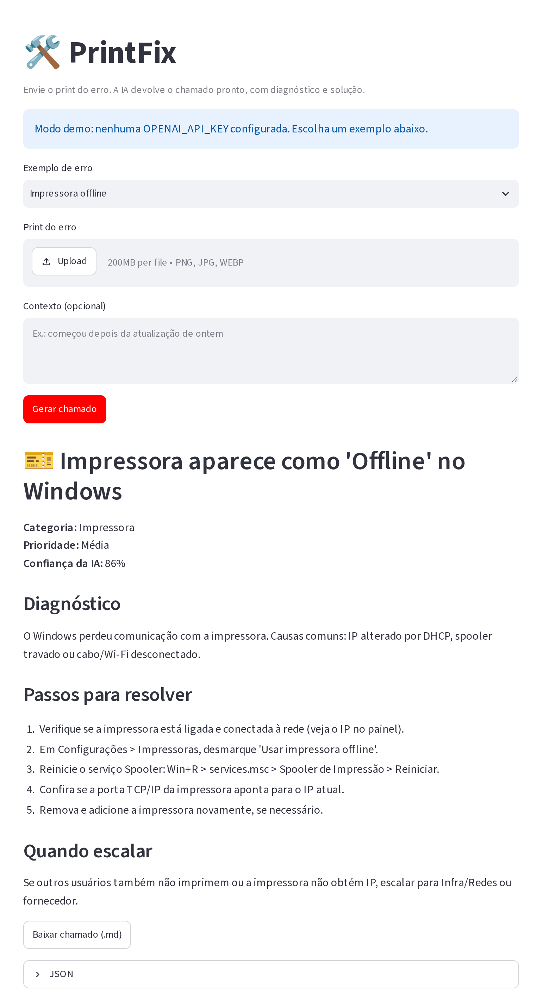
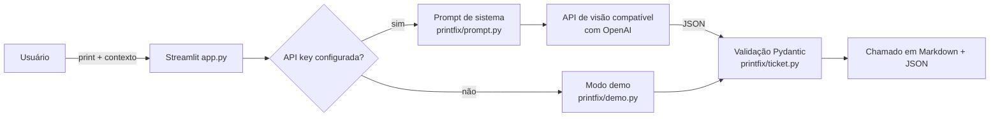

<div align="center">

# PrintFix

**Cole o print do erro. Receba o chamado de helpdesk pronto.**

Diagnóstico, causa provável, passo a passo e quando escalar, em português.

[](https://github.com/farrei/printfix/actions/workflows/ci.yml)




</div>

## O problema
Um "deu erro aqui" com um print anexado. Quem está no primeiro atendimento precisa interpretar a tela, pesquisar e registrar o chamado, e isso se repete o dia inteiro.

## O que o PrintFix faz
- Lê o print com um modelo de visão e identifica o erro
- Devolve título, categoria, prioridade e diagnóstico
- Lista os passos de solução e o critério para escalar para N2/Infra
- Exporta o chamado em Markdown e JSON
- Roda em **modo demo sem chave de API**, pronto para testar

## Por que fiz isso
Trabalhando com suporte, percebi que a maior parte do tempo do primeiro atendimento vai em entender o que o usuário está vendo. Chega um "deu erro aqui" com um print, e alguém precisa interpretar, pesquisar e registrar. O PrintFix faz essa primeira leitura: manda o print para um modelo com visão, identifica o erro e a causa provável e devolve um chamado com título, categoria, prioridade, diagnóstico, passos de solução e quando escalar.

## Como funciona


| Módulo | Responsabilidade |
|---|---|
| `printfix/prompt.py` | Prompt do analista N1/N2 com o formato JSON exigido |
| `printfix/client.py` | Configuração via env vars e chamada à API de visão |
| `printfix/ticket.py` | Modelo `Ticket` (Pydantic), normalização e exportação em Markdown |
| `printfix/demo.py` | Respostas de exemplo para rodar sem chave |
| `app.py` | Interface web |

## Rodando
```bash
git clone https://github.com/farrei/printfix.git && cd printfix
python -m venv .venv && source .venv/bin/activate   # Windows: .venv\Scripts\activate
pip install -r requirements.txt
streamlit run app.py
```
Sem chave de API o app abre em modo demo, com três casos prontos: impressora offline, Outlook pedindo senha e tela azul. Para usar um modelo de verdade, copie `.env.example` para `.env` e preencha `OPENAI_API_KEY`.

| Variável | Padrão | Descrição |
|---|---|---|
| `OPENAI_API_KEY` | vazio | Chave da API. Vazio = modo demo |
| `OPENAI_BASE_URL` | `https://api.openai.com/v1` | Qualquer provedor compatível com a API da OpenAI |
| `PRINTFIX_MODEL` | `gpt-4o-mini` | Modelo com suporte a imagem |

## Stack
Python, Streamlit, Pydantic e API compatível com OpenAI (visão). Testes com pytest e CI no GitHub Actions (Python 3.10 a 3.12).

## Testes
```bash
pytest -q
```
São 12 testes, todos passando. Eles usam um cliente falso, então rodam sem chave e sem internet.

## Próximos passos
- Abrir o chamado direto no GLPI ou Jira Service Management
- Base de conhecimento local com soluções já usadas pela equipe
- OCR offline como alternativa
- Histórico de chamados e métricas por tipo de erro

## English
PrintFix turns a screenshot of an IT error into a ready-to-file helpdesk ticket (title, category, priority, diagnosis, fix steps, escalation criteria) in Brazilian Portuguese, using any OpenAI-compatible vision model. Python, Streamlit, Pydantic; demo mode without an API key, 12 tests, CI.

## Autor
Rafael Verissimo, São Paulo. Estudante de Análise e Desenvolvimento de Sistemas (UNINTER), com experiência em suporte de TI. [github.com/farrei](https://github.com/farrei)

Licença [MIT](LICENSE).
