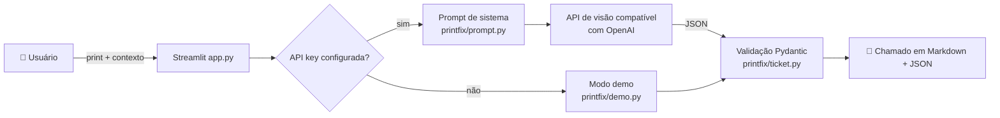

# 🛠️ PrintFix


 

> **Do print do erro ao chamado pronto em segundos.** Envie a captura de tela de um erro (Windows, impressora, Outlook...) e a IA devolve um chamado de helpdesk completo, em português.

## 🎯 O problema
No suporte de TI, boa parte do tempo vai para entender **o que** o usuário está vendo. Chega um "deu erro aqui" com um print e o técnico precisa interpretar, pesquisar e documentar. O PrintFix automatiza essa primeira análise (N1):

- 📸 lê o print com um modelo de IA com visão;
- 🧠 identifica o erro e a causa provável;
- 🎫 gera um chamado padronizado: **título, categoria, prioridade, diagnóstico, passos e quando escalar**.

## ⚙️ Como funciona


| Módulo | Responsabilidade |
|---|---|
| `printfix/prompt.py` | Prompt do analista N1/N2 com o formato JSON exigido |
| `printfix/client.py` | Configuração via env vars e chamada à API de visão |
| `printfix/ticket.py` | Modelo `Ticket` (Pydantic), normalização e exportação em Markdown |
| `printfix/demo.py` | Respostas de exemplo para rodar sem chave |
| `app.py` | Interface web |

## 🚀 Como rodar
```bash
git clone https://github.com/<seu-usuario>/printfix.git && cd printfix
python -m venv .venv && source .venv/bin/activate   # Windows: .venv\Scripts\activate
pip install -r requirements.txt
cp .env.example .env        # opcional: preencha OPENAI_API_KEY
streamlit run app.py
```
Sem chave, o app abre em **modo demo** com exemplos prontos (impressora offline, Outlook pedindo senha, tela azul).

### Configuração
| Variável | Padrão | Descrição |
|---|---|---|
| `OPENAI_API_KEY` | vazio | Chave da API. Vazio = modo demo |
| `OPENAI_BASE_URL` | `https://api.openai.com/v1` | Qualquer provedor compatível com OpenAI |
| `PRINTFIX_MODEL` | `gpt-4o-mini` | Modelo com suporte a imagens |

### Testes
```bash
pytest -q
```
Os testes usam um cliente falso, então não precisam de chave nem internet. O CI roda no GitHub Actions (Python 3.10–3.12).

## 🗺️ Roadmap
- [ ] Integração com GLPI / Jira Service Management para abrir o chamado direto
- [ ] Base de conhecimento local (RAG) com soluções já usadas pela equipe
- [ ] OCR offline como fallback
- [ ] Histórico de chamados e métricas de tipos de erro
- [ ] Extensão de navegador / atalho para capturar a tela direto

## 🇺🇸 English summary
**PrintFix** turns a screenshot of an IT error into a ready-to-file helpdesk ticket (title, category, priority, diagnosis, fix steps, escalation criteria) in Brazilian Portuguese, using any OpenAI-compatible vision model. Built with Python, Streamlit and Pydantic; includes a no-key demo mode, unit tests and CI.

## 👤 Autor
**Rafael Verissimo** — São Paulo, SP · Estudante de Análise e Desenvolvimento de Sistemas · Suporte Técnico de TI

Licença [MIT](LICENSE).
